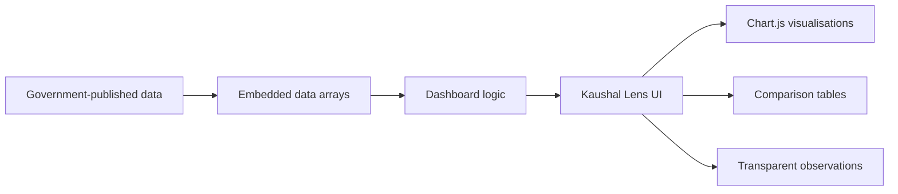

# Kaushal Lens

### Are India's skilling schemes actually translating training into jobs?

A lightweight, evidence-first dashboard for exploring PMKVY skilling outcomes across Indian states, with district-level trend data where publicly available.

**Smart India Hackathon 2026 · SIH26135**

> This is a hackathon prototype using published government data. It is not an official government tool.

---

## What the dashboard answers

| Question | What Kaushal Lens shows |
|---|---|
| How many candidates were trained and placed? | State-level trained vs placed comparison |
| Which states have higher/lower placement rates? | National comparison table |
| What happened at district level? | District-wise PMKVY placement trends where data is available |
| What does the education-to-employment pipeline look like? | National school → higher education → jobs context |
| Where should investigation go next? | Transparent, rule-based observations rather than a black-box score |

## Live demo

Open `index.html` directly in a browser, or serve the project with any static web server.

---

## The problem

Training numbers alone do not tell the whole story.

A skilling programme can train a large number of people while a much smaller number are recorded as placed. At the same time, district-level outcomes can vary substantially.

Kaushal Lens turns the published figures into an interactive dashboard so that a user can:

1. Select a state and district.
2. Inspect trained vs placed figures at state level.
3. Compare states nationally.
4. Explore district-level trends where the source provides them.
5. View the broader education-to-employment pipeline.
6. Read the data limitations before interpreting the results.

---

## What's on screen

- **State / district selector** — choose the geography before entering the dashboard.
- **Headline metric** — highlights the selected state's placement-rate figure from the included state dataset.
- **State comparison chart** — trained vs placed candidates.
- **National comparison tables** — highest and lowest placement-rate states in the included dataset.
- **District trend panel** — Maharashtra district-level PMKVY placement counts for 2019–20 to 2021–22.
- **Education pipeline** — national-level school → higher education → jobs context.
- **Action panel** — presents a transparent, data-driven observation for the selected state.
- **Source notes and limitations** — visible inside the dashboard rather than hidden in documentation.

---

## Data

### State-level PMKVY data

Source: Ministry of Skill Development & Entrepreneurship, Rajya Sabha Unstarred Question No. 1082, answered 31 July 2024.

The dashboard includes state-level trained and placed counts and calculates:

```text
placement rate = placed / trained × 100
```

### Maharashtra district-level PMKVY data

Source: Ministry of Skill Development & Entrepreneurship, Lok Sabha Unstarred Question No. 117, answered 22 July 2024.

The included district dataset covers 2019–20, 2020–21 and 2021–22 placement counts.

### Education pipeline

The dashboard uses national-level education figures as contextual background rather than presenting them as district-specific values.

Sources referenced by the project include:

- UDISE+ 2024–25
- AISHE 2023–24
- Economic Survey 2024–25

**Important:** verify the original government documents before using any number in a formal presentation, report, or publication.

---

## Architecture



The current prototype is intentionally simple:

- **Frontend:** HTML + CSS + JavaScript
- **Charts:** Chart.js 4.4.0
- **Data:** embedded JavaScript arrays
- **Backend:** none in the current version
- **Build system:** none required

---

## Project structure

```text
kaushal-lens/
├── index.html
├── README.md
├── docs/
│   ├── DATA_SOURCES.md
│   └── ARCHITECTURE.md
└── .github/
    └── workflows/
        └── static-check.yml
```

---

## Run locally

### Option 1 — open directly

Open `index.html` in a browser.

### Option 2 — VS Code Live Server

1. Open the project folder in VS Code.
2. Install/use Live Server.
3. Right-click `index.html`.
4. Select **Open with Live Server**.

### Option 3 — Python static server

```bash
python -m http.server 8000
```

Then open:

```text
http://localhost:8000
```

---

## Engineering notes

The project deliberately avoids presenting a black-box prediction model.

The current prototype uses:

- explicit source datasets,
- simple arithmetic for placement rates,
- transparent threshold-based flagging,
- visible caveats where the available data is incomplete.

This makes the dashboard easier to audit during a hackathon presentation.

---

## Limitations

### 1. District data is incomplete

The included district-level dataset does not provide a matching trained/enrolled denominator for every district. Therefore, district figures should be interpreted as **placement-count trends**, not automatically as district placement rates.

### 2. Maharashtra is the detailed district example

The current build contains real district-level trend data for Maharashtra. Other states can be selected for the state-level dashboard, but equivalent district data is not included for every state.

### 3. The dashboard is not an official government system

It is an independent hackathon prototype built from published information.

### 4. Context is not causation

A lower or higher placement figure does not, by itself, establish why that outcome occurred. Further analysis would need labour-market demand, sector, course, demographic and local economic data.

---

## Roadmap

- [ ] Move datasets from `index.html` into separate JSON/CSV files.
- [ ] Add district datasets for more states.
- [ ] Add sector-wise skill demand and job-posting data.
- [ ] Build a supply-vs-demand skill-gap heatmap.
- [ ] Add a small Flask/Node API.
- [ ] Add downloadable charts and filtered datasets.
- [ ] Add automated data validation.
- [ ] Add deployment configuration for a public demo.
- [ ] Add methodology documentation for every derived metric.

---

## Why the project is structured this way

The goal is not just to make a dashboard that looks impressive.

The repository is organised so a reviewer can quickly answer:

**What is the problem? → What data is used? → How is it transformed? → What does the dashboard show? → What are the limitations? → What would be built next?**

That makes the project easier to inspect, reproduce and explain during a hackathon evaluation.

---

## License

This repository contains a hackathon prototype. Add the license that matches your team's intended distribution before publishing.
