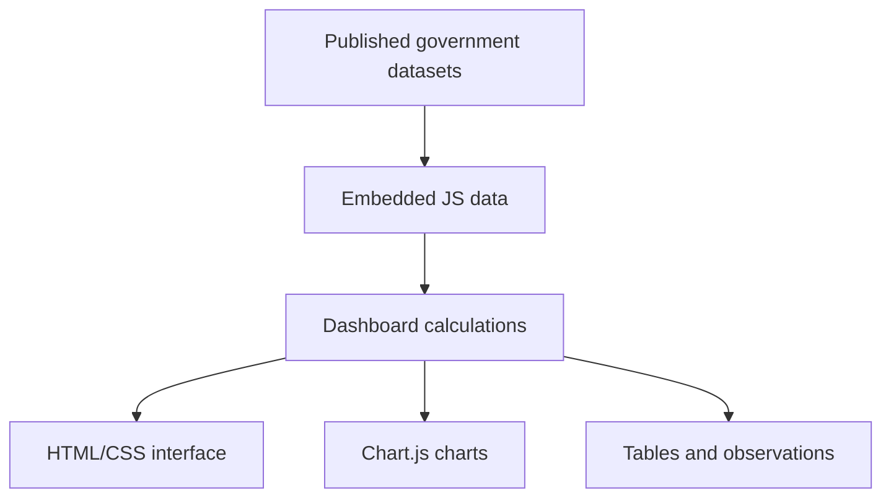
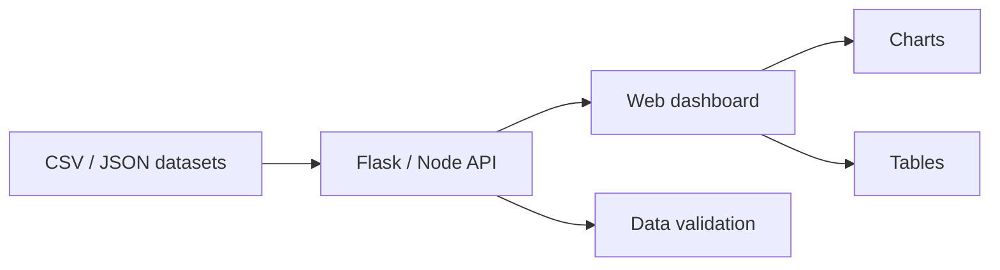

# Architecture

Kaushal Lens is currently a static frontend prototype.

## Current implementation

- `index.html` contains the interface, styles, data and application logic.
- Chart.js provides visualisations.
- No server-side API is required.
- No database is required.

## Suggested next architecture

This separation would make it easier to update the dataset without editing the UI code.
